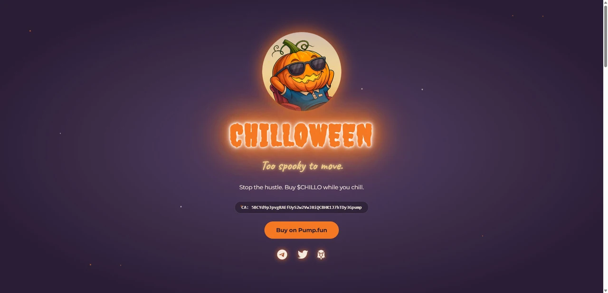
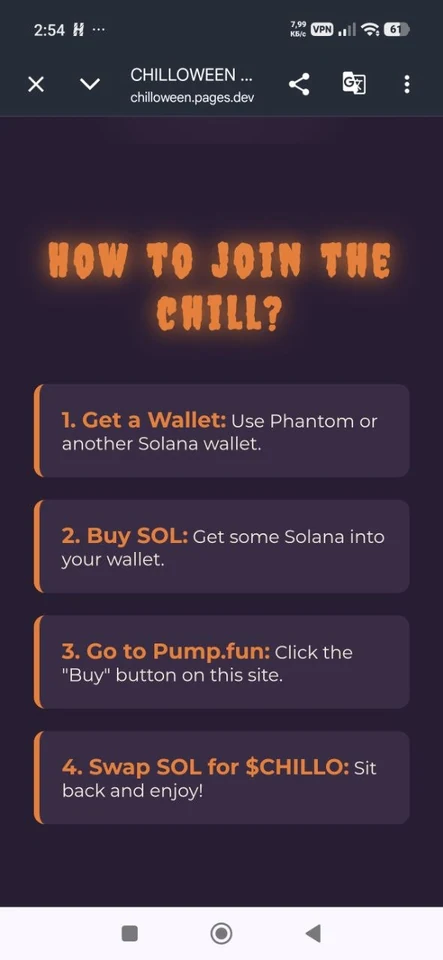

# Chilloween - двуязычный промосайт

Автор проекта - **Евгений Толмачев**. [Профиль GitHub](https://github.com/EvgenyET) · [Проект в портфолио](https://evgeny-dev.pro/project/Chilloween/chilloween_site.html)

Двуязычный промосайт CHILLOWEEN с токеномикой, инструкцией по участию и дорожной картой. Русская и английская версии, адаптивная графика и анимация разделов.

## Задача проекта

Основная задача - сохранить узнаваемый стиль и понятную навигацию в двух языковых версиях. Тематический шрифт, иллюстрации и анимация сопровождают содержание, а основные сведения остаются доступны при обычной прокрутке страницы.

## Мой вклад

Подготовил русскую и английскую страницы, структуру разделов и оформление в стиле CHILLOWEEN. Реализовал адаптивную вёрстку, переходы между языковыми версиями, копирование адреса контракта и эффекты появления. Настроил локальное подключение шрифтов и отображение текста на компьютере и телефоне.

## Интерфейс

**Первый экран Chilloween**

**Инструкция по участию на телефоне**

## Как работает приложение

Chilloween - иллюстрированный сайт, который объясняет идею токена CHILLOWEEN и помогает посетителю разобраться в порядке участия. Страница последовательно раскрывает описание, токеномику, инструкцию и план развития. Можно переключиться между русской и английской версиями, скопировать адрес контракта и открыть ресурсы сообщества. На телефоне разделы перестраиваются под вертикальное чтение.

## Возможности

- Полные русская и английская версии с переключением языка.
- Описание проекта, распределение токена, инструкция по участию и дорожная карта.
- Копирование адреса контракта из интерфейса.
- Адаптивное расположение текста и иллюстраций.
- Тематическая типографика с локальными шрифтами и эффекты при прокрутке.
- Прямые переходы к сообществу и ресурсам проекта.

## Техническое устройство

### Языковые версии

Русская и английская страницы повторяют маршрут посетителя. Переключение языка сохраняет знакомый порядок разделов, иллюстрации и оформление ссылок.

### Типографика

Локальный шрифт используется для тематических надписей. Размеры заголовков и интервалы между блоками приспособлены к широкому экрану и телефону.

### Иллюстрации

Логотип, персонаж и небольшие тематические изображения образуют общий набор ресурсов. Их можно увидеть как на первом экране, так и в разделах об участии в проекте.

## Технологии

| Технология | Роль в проекте |
| --- | --- |
| HTML5 | Семантические разделы и навигация. |
| CSS | Адаптивность и локальная типографика. |
| JavaScript | Обработка прокрутки и взаимодействий. |

## Демонстрация

На странице портфолио доступны описание, галерея и видеодемонстрация проекта. [Открыть Chilloween - двуязычный промосайт](https://evgeny-dev.pro/project/Chilloween/chilloween_site.html).
